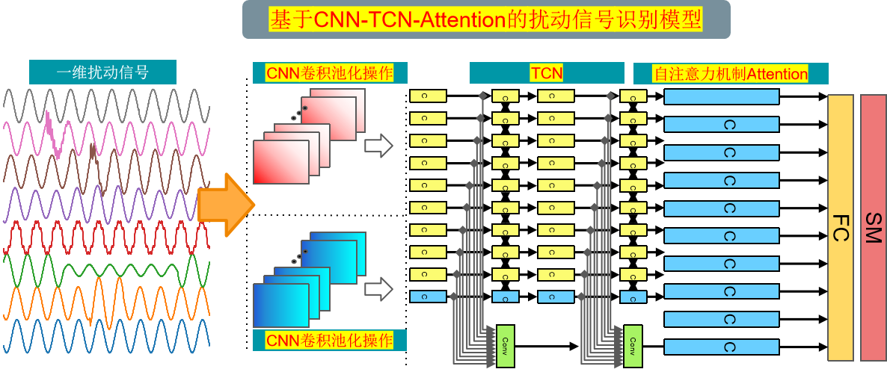
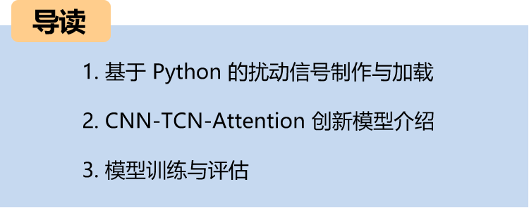
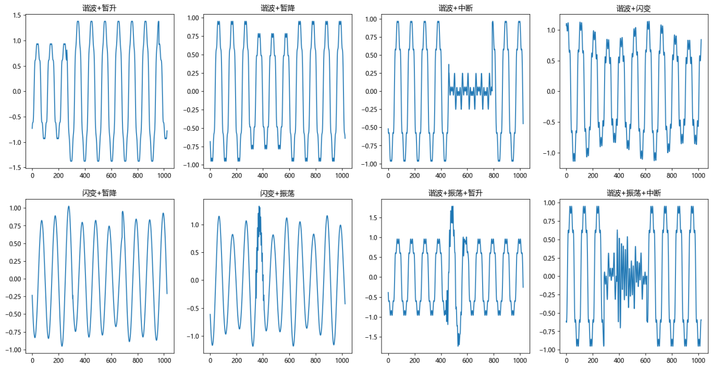
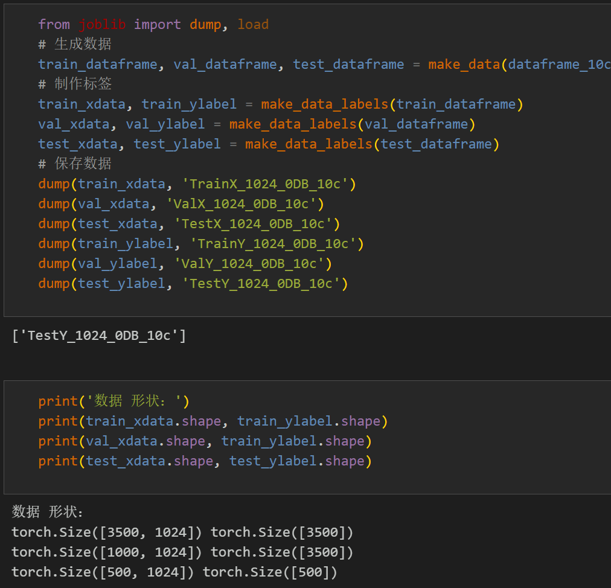
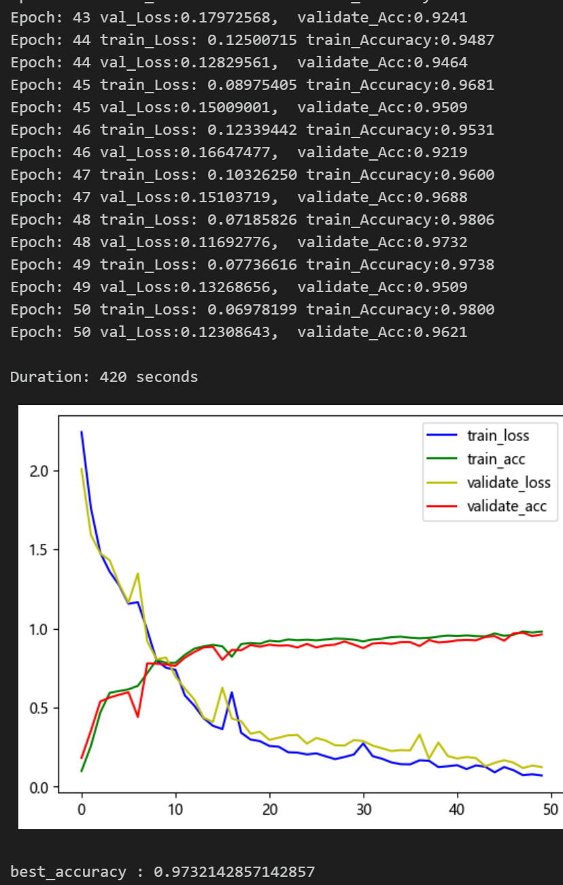
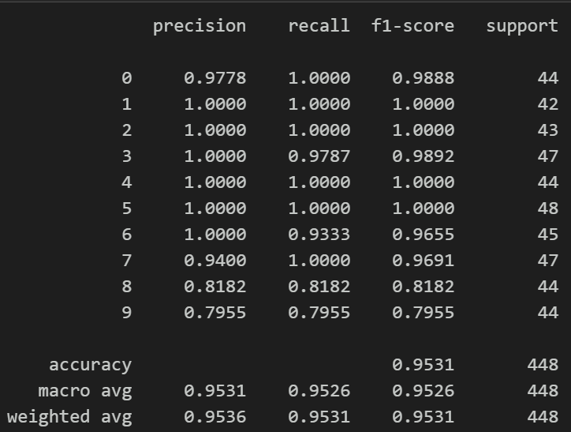
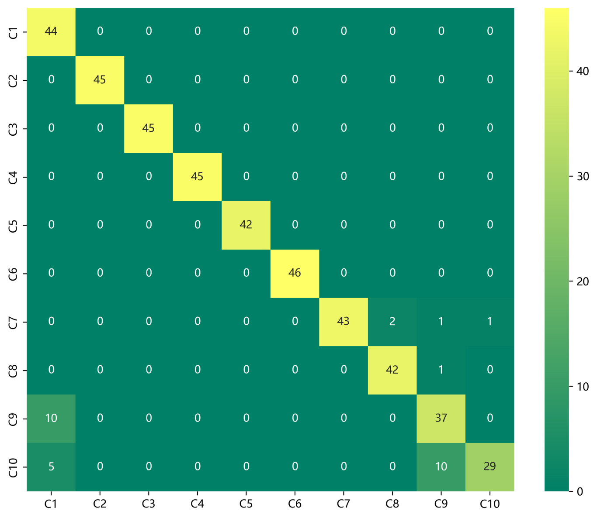
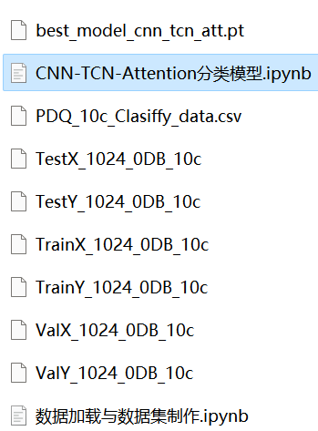

# Python Power Quality Disturbance Signal Classification (Part 7): Disturbance Signal Identification Model Based on CNN-TCN-Attention

Includes a complete dataset of power quality disturbance signals, as well as a fully generated and prepared dataset of ten types of disturbance signals, classified data, and label sets, all of which can be run.
Includes code for data preprocessing and the CNN-TCN-Attention classification model code.
The innovative network classification effect is significant, the model can fully extract spatial and temporal features as well as frequency domain features of signals, converges quickly, has excellent performance and high accuracy.
Environment: Python 3.9, PyTorch 1.8 and above are all acceptable.
\n        \n  
CNN-TCN-Attention model:
The input data dimension is [32, 1, 1024]. Firstly, it enters the CNN network for 1D convolutional pooling to extract spatial features. Then, the features after convolutional pooling are fed into the TCN layer to extract temporal features. Finally, multi-scale feature fusion is conducted through self-attention, and finally, it is fed into a fully connected layer and softmax for classification diagnosis.
Preface
This article is based on the power quality disturbance signal simulated by Python, which first undergoes data preprocessing to create and load the dataset. Finally, it implements a CNN-TCN-Attention model using Pytorch to classify the power quality disturbance signals. For a detailed introduction to the simulation of power quality disturbance signals in Python, please refer to the following text (Appendix 10 classification dataset at the end):
\tPython - Data Introduction and Classification of Electric Power Quality Disturbance Signals
The waveform diagram of some disturbed signal types is as follows:
1. Data preprocessing for disturbances in power quality
1.1 Import data
A disturbance signal model is constructed based on the IEEE Std1159-2019 Power Quality Detection Standard and related literature. Ten types of single signals and various composite disturbance signals are generated, including normal signals. Preprocessing for the 10-class classification of disturbance signals is conducted in reference to previous articles.
\t  
Step 1: Generate a single signal according to the formula model.
Single disturbance signal visualization:
\t  
\t  
2.2 Dataset Production
\tCreating dataset and classification labels
\t  
\t  
2. Disturbance Signal Identification Model Based on CNN-TCN-Attention
\t3.1 Define the CNN-TCN-Attention classification network model
3.2 Set parameters and train the model
50 epochs, with an accuracy nearing 97%. The CNN-TCN-Attention network achieves significant classification results. The CNN-TCN-Attention model effectively extracts multi-scale features from power quality disturbance signals, exhibits rapid convergence, and demonstrates exceptional performance, achieving noticeable results.
\tNote: Adjust parameters.
\tIt is appropriate to increase the number of TCN layers and the dimensionality per layer, and fine-tune the learning rate.
Adjust the number of CNN layers and the number of neurons per layer, increasing more epochs (note to prevent overfitting).
\tThe shape of a one-dimensional signal stacking can be changed (set the appropriate length and dimension).
3.3 Model Evaluation
Accuracy, Precision, Recall, F1 Score
\tFault classification confusion matrix:
Previously Featured Content:
Python - Data Introduction and Classification of Power Quality Disturbance Signals
Python Classification of Disturbance Signals in Electric Power Quality (I) One-Dimensional Signal Classification Based on LSTM Model
Python Classification of Disturbance Signals in Electric Power Quality (II) - One-Dimensional Signal Classification Based on CNN Model
Python Power Quality Disturbance Signal Classification (III) - One-Dimensional Signal Classification Model Based on Transformer
Python Power Quality Disturbance Signal Classification (IV) - One-Dimensional Signal Classification Model Based on CNN-BiLSTM
Python Power Quality Disturbance Signal Classification (V) One-Dimensional Signal Classification Model Based on CNN-Transformer
Power Quality Disturbance Identification Model Based on FFT + CNN - BiGRU-Attention for Time and Frequency Feature Attention Fusion
Power Quality Disturbance Identification Model Based on FFT + CNN -Transformer for Time and Frequency Feature Fusion
Python Power Quality Disturbance Signal Classification (VI) - Super Machine Learning Identification Model Based on Disturbance Signal Feature Extraction
FFT + CNN - BiLSTM-CrossAttention Power Quality Disturbance Identification Model with Cross Attention Fusion of Time and Frequency Features

## Images

<!-- PAYMENT_BLOCK -->

## Get this dataset

- Payment link (Stripe): [Buy now](https://buy.stripe.com/3cs8yP7sY87d0vu9AB)
- Payment QR code: 

<!-- /PAYMENT_BLOCK -->
